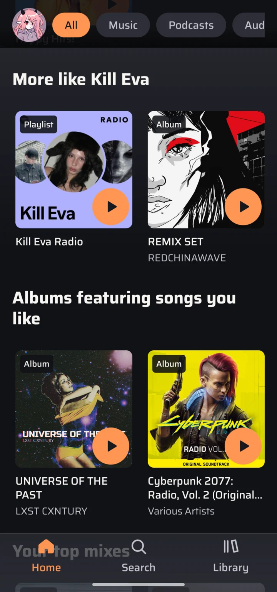
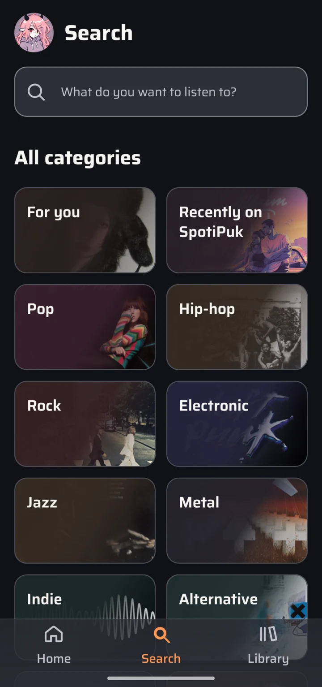

<p align="center">
  
</p>

<h1 align="center">SpotiPuk for Android</h1>

<p align="center">
  <strong>A native Android music client for Spotify.</strong><br>
  Find something to play, take your queue with you, and listen together with Jam.
</p>

<p align="center">
  <a href="https://spotipuk.stream/downloads/latest.apk"></a>
  <a href="https://spotipuk.stream"></a>
  <a href="https://github.com/Mirox921/SpotiPuk-Android/issues/new"></a>
</p>

<p align="center">
  <a href="#build-from-source"></a>
  <a href="https://github.com/Mirox921/SpotiPuk-Android/releases"></a>
  <a href="https://github.com/Mirox921/SpotiPuk-Android/stargazers"></a>
</p>

<p align="center">
  <a href="#screenshots">Screenshots</a> ·
  <a href="#features">Features</a> ·
  <a href="#how-it-works">How it works</a> ·
  <a href="#build-from-source">Build from source</a>
</p>

## Screenshots

<table align="center">
  <tr>
    <th>Home</th>
    <th>Search and browse</th>
    <th>Now playing</th>
  </tr>
  <tr>
    <td></td>
    <td></td>
    <td></td>
  </tr>
</table>

## Features

| Feature | What you can do |
| --- | --- |
| **Home and search** | Browse recommendations and genre categories. Search for tracks, albums, artists, playlists, podcasts, and episodes. |
| **Your library** | Browse saved music and podcasts, open playlist folders, and add tracks to your playlists. |
| **Now playing and queue** | Reorder the queue, shuffle, repeat, and set a sleep timer. Use the notification, the lock screen, or the home-screen widget to control playback. |
| **Spotify Connect** | See available devices, transfer playback, and control the active device. |
| **Jam** | Start or join a listening session by link, code, or QR. Share a queue with the group while participants play tracks through their own accounts. |
| **Podcasts and listening history** | Browse shows and episodes, see chapter markers when they are available, and revisit recent plays. |
| **Ember interface** | Use the Android UI in English, Ukrainian, Russian, Polish, or German. Switch languages from Settings. |

## How it works

| Layer | Implementation |
| --- | --- |
| **Android UI** | Kotlin, Jetpack Compose, and Material 3 render the Ember interface. The language selector updates app strings and leaves track, album, and playlist names as supplied by Spotify. |
| **Catalog and search** | The client loads the Spotify Home feed, fetches paginated search results, and combines account recommendations with the built-in browse catalog. |
| **Playback** | Media3 ExoPlayer prepares the current source. SpotiPuk manages queue order and saves an account-scoped playback snapshot. A foreground MediaLibraryService exposes playback controls and a browsable media library to Android. |
| **Connected devices** | The Connect client tracks the active Spotify device so the UI can reflect whether playback is local or remote. |
| **Group sessions** | The Android Jam client uses a hosted HTTPS service and a WebSocket connection to exchange queue and timing updates. Audio plays on participants' devices. |
| **Accounts and updates** | Sign-in opens Spotify's account page. The Android client stores saved sessions locally and checks release information on the SpotiPuk website. |

## Install or build

**Android 9 (API 28) or later** is required. Download the APK from the SpotiPuk website, open it on your device, and sign in with your Spotify account. Feature and content availability can vary by account and region. Source changes can appear here before the next website build.

### Build from source

Install **JDK 21** and **Android SDK Platform 35**. Open the project in Android Studio or set `ANDROID_HOME` to the Android SDK directory.

```sh
git clone https://github.com/Mirox921/SpotiPuk-Android.git
cd SpotiPuk-Android
./gradlew :app:testDebugUnitTest :app:assembleDebug
```

The debug APK is generated at `app/build/outputs/apk/debug/app-debug.apk`. Release builds use a separate local signing configuration.

## Feedback and credits

Use [Issues](https://github.com/Mirox921/SpotiPuk-Android/issues) to report a bug or suggest an improvement. For bugs, include the app version, Android version, and steps to reproduce.

The version badge reads the Android source version. Stars and download counts are refreshed daily. The download count covers assets published through this repository's GitHub Releases.

SpotiPuk is an independent project and is unaffiliated with Spotify. Earlier versions drew on deviato's Spotifuck project. The Ember interface uses the Saira typeface. [Saira font license](docs/third-party/Saira-OFL.txt)

## License

SpotiPuk's Android source code is licensed under the GNU General Public License, version 3 only (`GPL-3.0-only`). See [LICENSE](LICENSE). Third-party components and assets are governed by their respective license terms.
